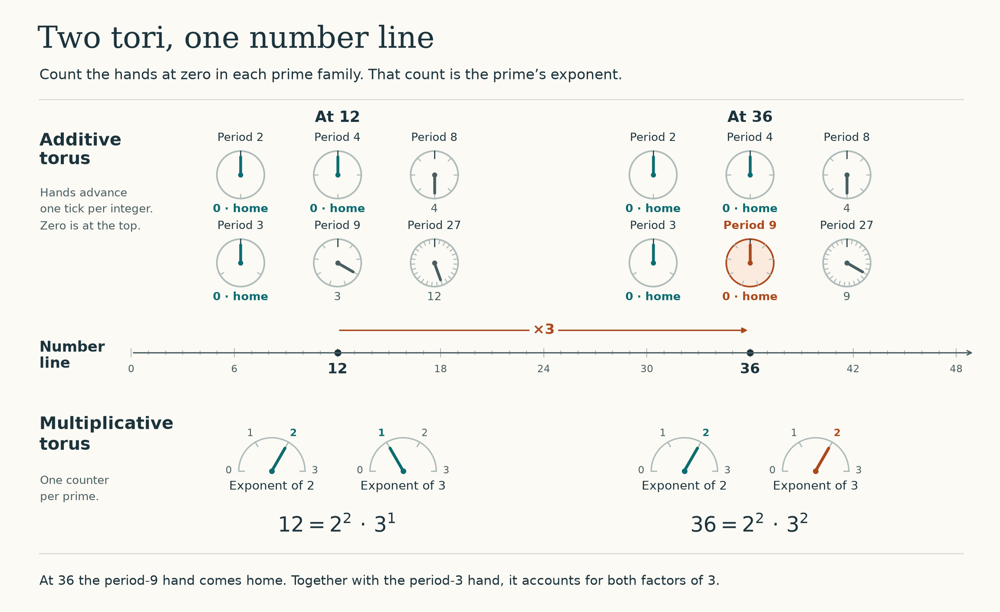
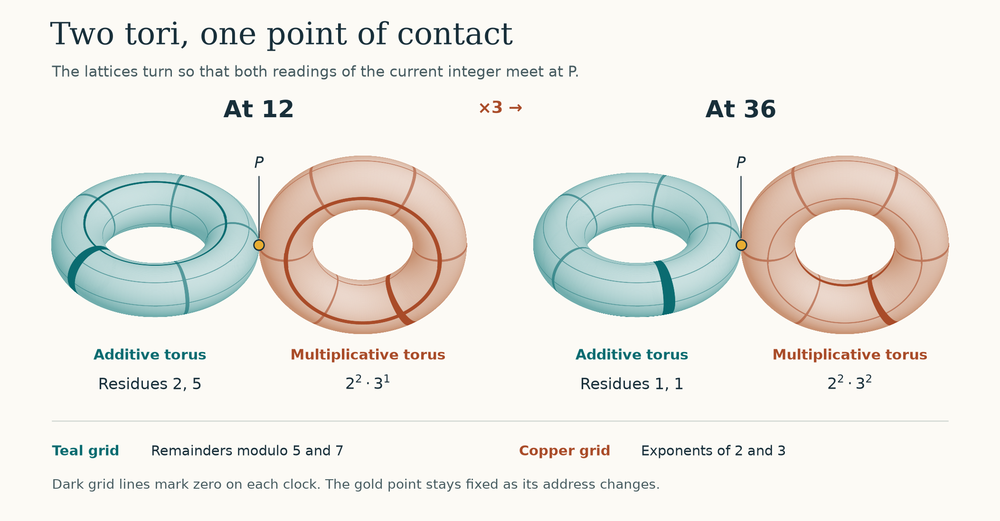

# RH through emergence — from the empty vacuum to the number line

## My background

Hello, my name is Chandler Stowell. I am a self-taught software engineer. I started teaching myself at the age of 13
when my favorite childhood game, Disney's Toontown Online, closed. I never went to college. I have always been curious
about how the world works. Below is my work on how I believe the number line emerges from a chain reaction in the
quantum vacuum. I had been working on this for a bit, and I had a feeling my model of the quantum vacuum and the number
line emerging could lead to a proof of RH. Thank you, [@\_\_alpoge\_\_](https://x.com/__alpoge__), for releasing your
Lean. Quickly looking at the released Lean, I noticed a dual lattice folder, which made me think of my two tori. I
thought of how I could connect my work to the released proof, and it seemed to work. My patch supplies the Gaussian
Fourier identity at the point where Levent's calculation uses it. I don't have the knowledge to fully verify the
entirety of my work. My knowledge of math and physics is very scattered. This work was developed from a
reverse-engineering perspective of the universe through my intuition. I am asking the math and science community if they
would be willing to take a look at it and let me know what they think.

If this work is correct, I believe it also gives insight on the Collatz conjecture. I have done some work demonstrating
GUT concepts through this emergence work, but it is not in the provided GitHub repository. I worked with Opus 5.5 to
build out my model of the vacuum, and the final cleaned-up folder, README, and formalizations were done with
GPT 6.2 Astra.

Thank you for your time. I look forward to seeing what people think and whether the work holds.

## How the work began

Back in March, I became really curious about prime numbers and how they worked. I wanted to figure out whether, given
the previous primes, I could generate the next through some sort of structure. This led me to thinking about how the
number line might work. I initially had thoughts of how each prime could be its own plane, and that our continuous
number line is just a 1D projection of something more significant taking place in the background. I ended up making
some cool visuals, but I didn't quite achieve my goal. Using the prime numbers as the input to a prime wave, sin(πx/p),
which crosses zero exactly at the multiples of p, I was able to discover on my own that if you made a plane for each
prime, with the plane holding the composites in the space between the current prime and the next, they resembled a
torus. Ultimately, the work didn't lead to anything besides some visuals; but the concepts stuck with me, and I began to
think of a torus as some sort of sacred natural geometry.

8 months later, I decided to entertain the problem again. This time I decided to think deeper. What is the explanation
for why you can iteratively build a torus from real numbers, creating planes for each prime, and having the planes'
edges pinned where the prime waves cross zero? I was left with the question: where does the number line come from? Why
does our math work? It was here that I started thinking of the quantum vacuum.

At this point, I had also developed an appreciation for symmetry. And then a thought clicked with me. Two particles in a
vacuum. A collision. A chain reaction. Emergence. Snapping my fingers made me feel as if I was creating a chain
reaction. Where do these two particles come from in the vacuum? I have no idea, but through their chain reaction, they
created the structure I was looking for. Two tori. Little did I know I would also be able to make a connection
to Minkowski spacetime and figure out that the number line also demonstrates a chain reaction that shapes our universe.

- Chandler Stowell

*All the text below was written by GPT 6.2 Astra. I helped it create an outline, and also guided it to include the
content I deemed necessary.*

## Terminology

**Vacuum background.** The birth pair meets in the vacuum background. Along the real coordinate $x$, its profile is the
Gaussian $g(x)=e^{-\pi x^2}$.
[Lean definition](src/RHThroughEmergence/Terminology.lean#L9 "vacuumBackgroundProfile")

**Vacuum background equation.** The real profile satisfies $g'(x)+2\pi xg(x)=0$ at every $x$, with $g(0)=1$. These
conditions determine the Gaussian uniquely among differentiable functions on the real line.
[\[T\]](src/RHThroughEmergence/Terminology.lean#L12 "vacuumBackgroundProfile_equation") ·
[\[T\]](src/RHThroughEmergence/VacuumOscillator.lean#L71 "vacuum_background_unique")

**Birth pair.** The two particles whose first contact begins the chain reaction. I picture one as a boson and the other
as a fermion. On the number line the birth pair has addresses 2 and 3, the two children of 1.
[Lean definition](src/RHThroughEmergence/Terminology.lean#L32 "birthPair")
[\[T\]](src/RHThroughEmergence/Terminology.lean#L34 "birthPair_addresses")

**Particle pair collision.** A meeting of two particles in the vacuum background. The birth pair makes the initial
contact. Particles that split off can meet again at later depths. In Lean, a collision records the participants’ two
addresses and their contact depth $v$. At the initial particle pair collision, the participants are the birth pair, the
contact depth is $v=0$, and the two reflected weights are both one.
[Lean definition](src/RHThroughEmergence/Terminology.lean#L37 "ParticlePairCollision") ·
[Initial contact](src/RHThroughEmergence/Terminology.lean#L42 "initialParticlePairCollision") ·
[\[T\]](src/RHThroughEmergence/Terminology.lean#L68 "initialParticlePairCollision_contact")

**Chain reaction.** An outgoing particle from one collision can take part in the next. On the number line, the chain
reaction starts at 1. From address $n$, each successive choice leads to $2n$ or $2n+1$. Lean computes the address
reached by following those choices from 1.
[Lean definition](src/RHThroughEmergence/Terminology.lean#L23 "chainReactionAddress")
[\[T\]](src/RHThroughEmergence/Terminology.lean#L26 "chainReactionAddress_append_bit")

## The chain reaction looked at from the number line

Read the first four places on the number line as the birth of a quantum vacuum. **0 is the perfect vacuum.** Nothing has
been counted. **1 marks the ground state.** On the number line, that first unit sets the scale against which a second
copy can be recognized. **2 and 3 are the addresses of the birth pair.** Put the unit beside itself and you reach 2.
Take one more unit step and you reach 3. Each now sets a rhythm of its own along the line.

The rhythm of 2 returns at 4, 6, 8, and so on. The rhythm of 3 returns at 6, 9, 12, and so on. Their rhythms first
coincide at the positive integer 6, the least common multiple of 2 and 3. Meanwhile, the same two moves that gave us 2
and 3 keep opening up the line. From 2 come 4 and 5. From 3 come 6 and 7. From any positive integer $n$ come its double
$2n$ and the next place $2n+1$. Every positive integer has exactly one path from 1, including the empty path at 1.
[\[T\]](src/RHThroughEmergence/Terminology.lean#L108 "chainReactionAddress_bijective") To see why, take
any $m>1$. If it is even, its only parent is $m/2$. If it is odd, its only parent is $(m-1)/2$. Each step goes to a
smaller positive integer, so tracing the parents always brings you back to 1. A new prime such as 5 starts a rhythm of
its own when the chain reaches it.

I call this the chain reaction because the rule can start again wherever it lands. Count in twos and the even sites form
a copy of the original line. Count in threes and another copy appears.

I think of Collatz as walking the chain reaction back toward 1. At an even number, halving undoes a doubling. At an odd
number $n$, the walk triples it and adds one. That lands on an even number, $3n+1$, where halving can begin again.
Take 5. Its parent in the doubling tree is 2. The Collatz walk goes from 5 to 16 first, then follows
$16\to8\to4\to2\to1$.

You can also trace those footsteps outward from 1. From any site $m$ you can double to $2m$. When $m$ is 4 more than a
multiple of 6, you can also go to $(m-1)/3$, the odd number whose Collatz step lands at $m$. That is how the outward
walk branches from 16 to 5. Whether these branches reach **every** positive integer is exactly the Collatz conjecture.
[Tao, statement of the conjecture](https://arxiv.org/abs/1909.03562)

## The chain reaction looked at from the vacuum

Picture the birth pair approaching each other in the vacuum background. Its Gaussian profile has the same shape in
position and in frequency.
[\[T\]](src/RHThroughEmergence/GaussianLattice.lean#L12 "gaussian_self_dual") I picture the boson
coming from the side where the sites are far apart and the fermion coming from the side where they are close together.
The boson carries the weight of the site at the origin. The fermion carries its reflected weight. At unit spacing each
weight is one. [\[T\]](src/RHThroughEmergence/GaussianLattice.lean#L18 "gaussian_lattice_fold") I take
that unit scale as the origin for the birth pair’s initial contact.

I picture particles splitting off at initial contact and moving through the vacuum background. I imagine the incoming
energy shared between the departing particles and what stays at the contact. The quantity the equations track is the
Minkowski interval of the pair, which stays equal to one. Follow one of those particles. When it meets another, the two
bring their energy together, and particles split off again. If those particles meet at depth $v$, that meeting is the
origin for their pair. When the chain reaches depth $u$, the depth measured from their meeting is $u-v$.

On the number line, I picture the boson tracing addition, one site at a time, and the fermion tracing multiplication,
first along the twos and the threes. At 6 you can see both motions at once. The additive path takes one more step
from 5. The multiplicative paths arrive by doubling 3 or tripling 2. Either arithmetic rule can start again at 6. If you
stand on the multiples of 6 and take their spacing as your unit, you see the same pattern of sites stretching out ahead
of you. Each new meeting takes place in the same vacuum background.

## The vacuum background, the birth pair and supersymmetry

### Representations of the reflected weights

Let $a>0$ be the square of the lattice spacing and write $a=e^{2u}$. Reflection exchanges $u$ and $-u$. The weight of
the empty site in the original picture is $e^{u/2}$ and its weight in the reflected picture is $e^{-u/2}$. Their sum is
$B(u)$ at any depth. At $u=0$ the weights are equal and $B(0)=1+1=2$. I use this equality to mark the birth pair’s
initial contact. The four representations below give the same sum.

$$
B(u)=
\underbrace{e^{u/2}}_{\text{empty site}}
+\underbrace{e^{-u/2}}_{\text{reflected empty site}}
=\underbrace{2\cosh(u/2)}_{\text{sum of the two weights}}.
$$

| Representation | Where the two weights appear |
| --- | --- |
| Sampled vacuum background | For $\theta(a)=\sum_{m\in\mathbb Z}e^{-\pi m^2a}$, the fold reads $a^{1/4}\theta(a)=a^{-1/4}\theta(1/a)$. The $m=0$ term on each side has weight $a^{1/4}$ or $a^{-1/4}$. [\[T\]](src/RHThroughEmergence/GaussianLattice.lean#L18 "gaussian_lattice_fold") |
| Supersymmetric modes | The generator of changes of scale gives the constant function and $x^{-1}$ the respective eigenvalues $+1/2$ and $-1/2$. [\[T\]](src/RHThroughEmergence/VacuumOscillator.lean#L49 "reflected_scale_modes") Evolving them through depth $u$ gives the two terms of $B(u)$. |
| Minkowski spacetime | Take $L_\pm=e^{\pm u/2}$, $T=(L_++L_-)/2$ and $X=(L_+-L_-)/2$. The interval is $T^2-X^2=L_+L_-$. [\[T\]](src/RHThroughEmergence/Minkowski.lean#L18 "interval_eq") Here it equals one, $B(u)=2T$, and initial contact corresponds to the rest point $(T,X)=(1,0)$. |
| Convex geometry | Add the unit square to an axis-aligned rectangle of sides $L_+,L_-$ by taking all pairwise sums of points. The resulting rectangle has area $(1+L_+)(1+L_-)=2+B(u)$. Subtract the two original unit areas to recover $B(u)$, twice their mixed area. |

For a pair whose contact is at global depth $v$, use the same weights at local depth $u-v$. Their sum is
$B(u-v)=2\cosh((u-v)/2)$. Both weights equal one at contact, and they agree exactly when $u=v$. This describes a pair
once its contact depth has been specified.
[\[T\]](src/RHThroughEmergence/Terminology.lean#L59 "weightsAt_sum")
[\[T\]](src/RHThroughEmergence/Terminology.lean#L50 "weightsAt_contact")
[\[T\]](src/RHThroughEmergence/Terminology.lean#L54 "weightsAt_equal_iff")

### The vacuum background

The vacuum background has a real component and a component at every prime. The real component is the Gaussian $g$. At
each prime $p$, the local vacuum is the indicator of the $p$-adic integers $\mathbb Z_p$. Tate’s formula combines them
into one state. For $s=\sigma+it$ with $\sigma>1$,

$$
\begin{aligned}
\Phi_0(x)
 &=\underbrace{g(x_\infty)}_{\text{real Gaussian}}\,
   \underbrace{\prod_p\mathbf1_{\mathbb Z_p}(x_p)}_{\text{finite-place vacua}},\\[6pt]
Z(s)
 &=\int_{\mathbb A^\times}\Phi_0(x)|x|_{\mathbb A}^{s}\,d^\times x\\
 &=\underbrace{\pi^{-s/2}\Gamma(s/2)}_{\text{real Mellin factor }\,\Gamma_{\mathbb R}(s)}
   \;\underbrace{\zeta(s)}_{\text{Euler product}}.
\end{aligned}
$$

Here $x$ has one real coordinate and one coordinate at every prime. The integral runs over the nonzero local coordinates
that are units at almost all primes, with each finite unit group given volume one and real measure $dx/|x|$. Put
$u=|x_\infty|^2$. Both real signs together give $du/u$, and the real integral of $u^{s/2}e^{-\pi u}$ gives
$\Gamma_{\mathbb R}(s)$. Each surviving finite valuation vector gives one positive integer $n$, with shell weight
$n^{-s}$. The shell sum uses the classical decomposition of idèle Haar measure into valuation shells. Lean checks its
value for $\Re s>1$. [\[T\]](src/RHThroughEmergence/VacuumIntegrals.lean#L37 "realShell_eq_gamma") ·
[\[T\]](src/RHThroughEmergence/VacuumIntegrals.lean#L47 "vacuum_shells_hasSum") The resulting value is
$\Gamma_{\mathbb R}(s)\zeta(s)$.
[\[T\]](src/RHThroughEmergence/GaussianLattice.lean#L59 "floor_times_lattice")

### The vacuum background reconstructed from primes and zeta zeros

Sampling the Gaussian $g$ at the positive lattice sites gives $\psi(a)=(\theta(a)-1)/2=\sum_{n\ge1}g(n\sqrt a)$. This is
the **sampled vacuum background** on the positive half of the lattice. To build it **from primes**, choose an exponent
$k_p\ge0$ at each prime, with only finitely many nonzero. The all-zero choice gives the site $1$. Unique factorization
supplies every positive site exactly once, so

$$
\psi(a)=\sum_{(k_p)}\exp\!\left[-\pi a\,
  \underbrace{\prod_p p^{2k_p}}_{\text{squared lattice site }n^2}\right].
$$

Lean proves convergence of this prime-exponent sum to $\psi(a)$ for every $a>0$.
[\[T\]](src/RHThroughEmergence/Reconstruction.lean#L17 "prime_reconstruction") In Mellin coordinates
this enumeration becomes Euler’s product $\zeta(s)=\prod_p(1-p^{-s})^{-1}$ for $\sigma>1$.
[\[T\]](src/RHThroughEmergence/GaussianLattice.lean#L67 "bosons_euler_product") To build
**the same sampled vacuum background from zeta**, take the inverse Mellin transform. For $a>0$ and any $c>1$,

$$
\psi(a)=\frac{1}{4\pi i}\int_{c-i\infty}^{c+i\infty}
  \underbrace{\Gamma_{\mathbb R}(s)}_{\text{real Mellin factor}}\,
  \underbrace{\zeta(s)}_{\text{integer lattice}}\,
  \underbrace{a^{-s/2}}_{\text{inverse Mellin kernel}}\,ds .
$$

Expanding $\zeta(s)$ on that vertical line recovers $g(n\sqrt a)$ term by term. The factor $1/(4\pi i)$ comes from using
$s/2$ as the Mellin variable.
[\[T\]](src/RHThroughEmergence/MellinReconstruction.lean#L121 "zeta_reconstruction") To recover a
single copy of the Gaussian, weight the resampled lattices by the Möbius function $\mu$. In
$\sum_{d\ge1}\mu(d)\psi(d^2a)$ the coefficient of $g(n\sqrt a)$ is $\sum_{d\mid n}\mu(d)$, equal to one at $n=1$ and
zero thereafter. Thus the sum is $g(\sqrt a)$.
[\[T\]](src/RHThroughEmergence/Reconstruction.lean#L73 "moebius_reconstruction")

**From the zeta zeros.** Put $\xi(s)=\tfrac12s(s-1)Z(s)$ away from the two poles and extend it at $0$ and $1$. Its zeros
are precisely the zeros of $\zeta$ in $0<\Re s<1$, with the same multiplicities.
[\[T\]](src/ZeroProduct/ZeroReconstruction.lean#L118 "xi_zero_iff")
[\[T\]](src/ZeroProduct/ZeroReconstruction.lean#L147 "xi_zeta_order")

Form the product $D$ from those zeros. Its finite partial products converge locally uniformly in $s$.
[\[T\]](src/ZeroProduct/ZeroReconstruction.lean#L171 "zero_product_converges")

$$
D(s)=\prod_{\rho}
  \underbrace{(1-s/\rho)e^{s/\rho}}_{\text{one factor per zero, counted with multiplicity}}.
$$

Hadamard factorization gives $\xi(s)=e^{A+Bs}D(s)$. The normalization of $\xi$ fixes $e^A=\xi(0)=1/2$. To recover the
other exponential, take $u=(1+s)/2$ and $v=(1-s)/2$. Reflection gives $\xi(u)=\xi(v)$, and $u-v=s$. Therefore
$D(v)/D(u)=e^{Bs}$ on $\Re s>1$, where $D(u)\ne0$. Every factor in the following reconstruction is now specified by the
zeros and the normalization. [\[T\]](src/ZeroProduct/ZeroReconstruction.lean#L31 "xi_from_zeros")

$$
Z(s)=
\underbrace{\frac{1}{s(s-1)}}_{\text{two poles}}\,
\underbrace{D(s)}_{\text{zero product}}\,
\underbrace{\frac{D((1-s)/2)}{D((1+s)/2)}}_{\text{reflection fixes the exponential}},
\qquad \Re s>1 .
$$

Insert this expression into the inverse Mellin integral above.
[\[T\]](src/ZeroProduct/ZeroReconstruction.lean#L73 "completed_from_zeros")
[\[T\]](src/ZeroProduct/ZeroReconstruction.lean#L86 "zero_reconstruction") For **every $a>0$** the sum
over finite prime-exponent vectors converges to exactly that integral over zero data. Möbius inversion then gives
$g(\sqrt a)=e^{-\pi a}$ from the zero integrals alone. As $a\downarrow0$, the recovered Gaussian tends to $g(0)=1$.
[\[T\]](src/ZeroProduct/ZeroReconstruction.lean#L91 "primes_equal_zeros")
[\[T\]](src/ZeroProduct/ZeroReconstruction.lean#L99 "gaussian_from_zeros")
[\[T\]](src/ZeroProduct/ZeroReconstruction.lean#L181 "gaussian_from_zeros_at_origin")

**[prior]** The classical paired form displays the reflection directly. Each zero $\rho$ in the upper half-plane pairs
with $1-\rho$ in the lower half-plane, counting multiplicity.

$$
\xi(s)=\underbrace{\tfrac12}_{\xi(0)}
  \prod_{\Im\rho>0}
  \underbrace{\left(1-\frac{s(1-s)}{\rho(1-\rho)}\right)}
             _{\text{one zero pair }(\rho,1-\rho)}.
$$

**[prior]** One can also compare the prime and zero readings at a single scale. Use a Gaussian of heat time $\tau>0$,
with density in depth $k_\tau(u)=e^{-u^2/(4\tau)}/\sqrt{4\pi\tau}$. Write $\gamma_\rho=(\rho-\tfrac12)/i$, allowing
complex values. Summing over **all** nontrivial zeros with multiplicity, Weil’s formula gives

$$
\begin{aligned}
&\underbrace{\sum_\rho e^{-\tau\gamma_\rho^2}}_{\text{zeros}}
 =\underbrace{2e^{\tau/4}}_{\text{two pole contributions}}\\[4pt]
&\quad+\underbrace{\frac{1}{2\pi}\int_{\mathbb R}e^{-\tau r^2}
 \left[\Re\frac{\Gamma'}{\Gamma}\!\left(\tfrac14+\tfrac{ir}{2}\right)-\log\pi\right]dr}_{\text{floor}}\\[4pt]
&\quad-\underbrace{2\sum_p\sum_{j\ge1}\frac{\log p}{p^{j/2}}\,k_\tau(j\log p)}_{\text{primes}}.
\end{aligned}
$$

The **two pole contributions** come from the poles at $s=0$ and $s=1$, one for each reflected origin weight. The
**floor** comes from the real Gaussian’s gamma factor. The **primes** term samples the heat kernel at each tick of each
prime clock. The Gaussian Fourier integral gives exactly $k_\tau(u)$ with the displayed normalization. The prime series
converges absolutely for every $\tau>0$, and reindexing its nonzero terms by $(p,j)$ gives the double sum above.
[\[T\]](src/RHThroughEmergence/WeilHeat.lean#L14 "gaussian_test_transform") ·
[\[T\]](src/RHThroughEmergence/WeilHeat.lean#L36 "prime_heat_summable") ·
[\[T\]](src/RHThroughEmergence/WeilHeat.lean#L75 "prime_heat_reindex")

On a vertical line $s=c+ir$ with $c>1$, the Gaussian test can be integrated term by term against the prime logarithmic
derivative. For every $\tau>0$ this gives

$$
\frac1{2\pi}\int_{\mathbb R}e^{\tau(s-1/2)^2}
\left(-\frac{\zeta'(s)}{\zeta(s)}\right)\,dr
=\sum_{n\ge1}\frac{\Lambda(n)}{\sqrt n}\,k_\tau(\log n).
$$

The shift of each Gaussian mode and absolute convergence justify this identity.
[\[T\]](src/RHThroughEmergence/WeilHeat.lean#L96 "shifted_gaussian_test") ·
[\[T\]](src/RHThroughEmergence/WeilHeat.lean#L162 "prime_heat_integral")

The full heat-trace equality above is the classical Gaussian Weil formula. Passing from the checked right-hand contour
to the zero sum and gamma integral still requires a formal contour argument that counts zeros with multiplicity.

### The supersymmetric representation

The oscillator represents $\mathfrak{osp}(1|2)$ on functions of position. Its two odd operators are multiplication by
position, $Mf(x)=xf(x)$, and differentiation, $Df=f'$. Both reverse parity. Acting on an even function, each produces an
odd one. Their anticommutator is the sum $MD+DM$. By the product rule, half that sum acts as

$$
Hf(x)=\tfrac12\big(xf'(x)+(xf(x))'\big)
=\underbrace{xf'(x)}_{\text{change of scale}}
+\underbrace{\tfrac12 f(x)}_{\text{normalization}}.
$$

Thus $H=\tfrac12\{M,D\}$.
[\[T\]](src/RHThroughEmergence/VacuumOscillator.lean#L26 "slide_eq_anticommutator") It generates
changes of scale. Differentiating $e^{u/2}f(e^u x)$ in $u$ at $u=0$ gives exactly $Hf(x)$.
[\[T\]](src/RHThroughEmergence/VacuumOscillator.lean#L117 "dilation_generator") For twice
differentiable $f$, applying the product rule twice gives $[D^2,M^2]f=4Hf$, where $[P,Q]=PQ-QP$.
[\[T\]](src/RHThroughEmergence/VacuumOscillator.lean#L101 "oscillator_commutator")

On $x>0$ the reciprocal fold $Jf(x)=x^{-1}f(1/x)$ exchanges the scale modes $x^{-s}$ and $x^{-(1-s)}$. Applying it twice
returns the original function. The mode exchange holds for complex $s$, and the involution holds for every real-valued
function at $x>0$. [\[T\]](src/RHThroughEmergence/VacuumOscillator.lean#L128 "fold_complex_mode")
[\[T\]](src/RHThroughEmergence/VacuumOscillator.lean#L92 "fold_mode") ·
[\[T\]](src/RHThroughEmergence/VacuumOscillator.lean#L88 "fold_fold")

In the Fourier convention used below, the oscillator’s lowering and raising operators are $A=D+2\pi M$ and
$A^\dagger=-D+2\pi M$. The lowering operator annihilates the oscillator’s **ground state**. In position coordinates,
$Ag=0$ gives the equation for the vacuum background, $g'(x)+2\pi xg(x)=0$.
[\[T\]](src/RHThroughEmergence/VacuumOscillator.lean#L19 "vacuum_background_equation")

This explains why the background has a Gaussian profile. Multiplying the equation by $e^{\pi x^2}$ gives
$(e^{\pi x^2}g(x))'=0$. The product is constant, and $g(0)=1$ fixes that constant at one. Thus the normalized equation
has exactly one differentiable solution on the real line, $g(x)=e^{-\pi x^2}$.
[\[T\]](src/RHThroughEmergence/VacuumOscillator.lean#L71 "vacuum_background_unique") Applying
$A^\dagger$ once gives the odd state $4\pi xg(x)$.

To see why Fourier transformation fixes the Gaussian ground state, write its transform as

$$
F(y)=\widehat g(y)=\int_{\mathbb R}
 \underbrace{g(x)}_{\text{oscillator ground state}}\,
 \underbrace{e^{-2\pi ixy}}_{\text{Fourier kernel}}\,dx.
$$

Differentiating under the integral gives $F'=-2\pi i\,\widehat{xg}$. Integration by parts gives
$\widehat{g'}=2\pi i yF$, since the Gaussian decays at both ends. Substituting the vacuum background equation
$g'=-2\pi xg$ yields $F'(y)=-2\pi yF(y)$. Even the normalization agrees. Squaring the positive integral $F(0)$ and
integrating in polar coordinates gives $F(0)^2=2\pi\int_0^\infty r e^{-\pi r^2}\,dr=1$. Thus $F$ and $g$ solve the same
equation with the same initial value. This derives $\widehat g=g$ from the vacuum equation. The patch supplies that same
identity to Levent’s module by invoking Mathlib’s Gaussian Fourier theorem.
[\[T\]](src/RHThroughEmergence/GaussianLattice.lean#L12 "gaussian_self_dual") The same calculation
gives $\widehat{xg}(y)=-iyg(y)$ for the odd state.

The heat kernel gives a family of Gaussian profiles of different widths. At heat time $\tau>0$ it is
$k_\tau(x)=(4\pi\tau)^{-1/2}e^{-x^2/(4\tau)}$. Scaling the Fourier identity above gives
$\widehat k_\tau(y)=e^{-4\pi^2\tau y^2}$. At $\tau=1/(4\pi)$ both sides equal the Gaussian ground state $g$. Its Mellin
transform, which measures scale, is also explicit. Substituting $v=\pi x^2$ gives

$$
\int_0^\infty
 \underbrace{g(x)}_{\text{Gaussian}}\,
 \underbrace{x^{s-1}}_{\text{Mellin weight}}\,dx
 =\tfrac12\underbrace{\pi^{-s/2}\Gamma(s/2)}_{\Gamma_{\mathbb R}(s)},
 \qquad \Re s>0.
$$

For real $s>0$ this Mellin identity is formalized in Lean.
[\[T\]](src/RHThroughEmergence/GaussianLattice.lean#L25 "gaussian_mellin") Here
$\Gamma(z)=\int_0^\infty e^{-v}v^{z-1}\,dv$ for $\Re z>0$.

The same Gaussian ground state helps me read Levent’s higher-dimensional vacuum. Let $X$ and $Y$ be real symmetric forms
with $Y$ positive definite. Choose coordinates $B$ so that $Y(x,x)=\lVert Bx\rVert^2=\sum_j (Bx)_j^2$. In these
coordinates the vacuum factors as

$$
e^{i\pi X(x,x)-\pi Y(x,x)}
 =\underbrace{e^{i\pi X(x,x)}}_{\text{quadratic phase}}\,
  \underbrace{\prod_j g((Bx)_j)}_{\text{one Gaussian per coordinate}}.
$$

### The prime clocks and the finite-place vacuum

The real Gaussian has a counterpart at each prime $p$. For a rational $r\ne0$ write $v_p(r)$ for the exponent of $p$ in
its numerator minus the exponent in its denominator. The local vacuum $\mathbf1_{\mathbb Z_p}$ accepts $r$ when
$v_p(r)\ge0$, and also accepts zero. A rational in lowest terms passes every local test exactly when its denominator is
one. Thus the finite-place vacua together select the diagonal integer lattice inside the rationals.

At the real place the Fourier transform fixes the Gaussian. At a prime, with the standard additive character trivial
exactly on $\mathbb Z_p$ and $\mathbb Z_p$ of volume one, the integral of a character over $\mathbb Z_p$ is one when it
is trivial there and zero otherwise. This gives $\widehat{\mathbf1_{\mathbb Z_p}}=\mathbf1_{\mathbb Z_p}$. Outside
$\mathbb Z_p$, translation by one preserves the integral and multiplies it by a character value different from one,
forcing the integral to vanish.
[\[T\]](src/RHThroughEmergence/VacuumIntegrals.lean#L13 "unit_ball_fourier")

A positive integer also has a unique decomposition $n=mk^2$ with $m$ squarefree. For each prime, put the largest even
part of its exponent into $k^2$ and the remainder into $m$. In the paper’s supersymmetric reading, $m$ carries the
fermionic part and $k^2$ the paired part. Summing the possible exponents of each prime gives, for $\Re s>1$,

$$
\begin{aligned}
\zeta(s)&=\sum_{n\ge1}n^{-s}=\prod_p(1-p^{-s})^{-1}\\
 &=\underbrace{\zeta(2s)}_{\text{squares }k^2}\;
   \underbrace{\prod_p(1+p^{-s})}_{\text{squarefree part }m},\\[5pt]
\sum_{m\ {\rm squarefree}}m^{-s}
 &=\prod_p(1+p^{-s})=\frac{\zeta(s)}{\zeta(2s)}.
\end{aligned}
$$

### From the lattice fold to the explicit formula

Sample the Gaussian ground state at integer sites at a scale $a>0$. To see what becomes of its Fourier symmetry, form
its period-one sum $P_a(x)=\sum_{m\in\mathbb Z}g(\sqrt a\,(x+m))$. Its $k$th Fourier coefficient is the integral over
one period against $e^{-2\pi ikx}$. Joining the translated unit intervals and substituting $v=\sqrt a\,x$ in the
resulting integral gives $a^{-1/2}\widehat g(k/\sqrt a)=a^{-1/2}e^{-\pi k^2/a}$. Both series converge absolutely. At
$x=0$ the periodic sum and its Fourier series therefore give

$$
\theta(a):=\underbrace{\sum_{m\in\mathbb Z}e^{-\pi m^2a}}_{\text{sampled Gaussian}}
=\underbrace{a^{-1/2}}_{\text{change of scale}}\,
 \underbrace{\theta(1/a)}_{\text{reflected lattice sum}}.
$$

In this fold, the origin contributes $1$ on the first side and $a^{-1/2}$ on the reflected side. The two weights agree
at $a=1$. I read this equality of weights as the birth pair’s initial contact. The number line gives the two members of
the birth pair the addresses 2 and 3.

Pair the sites $m$ and $-m$ and put $\psi(a)=(\theta(a)-1)/2=\sum_{m\ge1}e^{-\pi m^2a}$. For $\Re s>1$, absolute
convergence lets us take the Mellin transform term by term. Substituting $v=\pi m^2a$ in each integral gives the same
Gaussian factor times $m^{-s}$. The result is completed zeta,

$$
Z(s):=\int_0^\infty\psi(a)a^{s/2}\frac{da}{a}
=\underbrace{\pi^{-s/2}\Gamma(s/2)}_{\text{real Mellin factor}}\,
 \underbrace{\zeta(s)}_{\text{integer lattice}}.
$$

The Mellin identity holds across the whole half-plane $\Re s>1$.
[\[T\]](src/RHThroughEmergence/MellinReconstruction.lean#L18 "theta_hasMellin") Now split the integral
at the unit scale $a=1$. The theta identity gives $\psi(a)=a^{-1/2}\psi(1/a)+(a^{-1/2}-1)/2$. In the lower half of the
integral, the first term changes $s$ to $1-s$ after the substitution $a\mapsto1/a$. The last two terms integrate to
$1/(s-1)-1/s$. Hence

$$
\begin{aligned}
Z(s)&=\underbrace{-\frac1s}_{\text{empty site}}
      +\underbrace{\frac1{s-1}}_{\text{reflected empty site}}\\[4pt]
 &\quad+\underbrace{\int_1^\infty\psi(a)
       \big(a^{s/2}+a^{(1-s)/2}\big)\frac{da}{a}}_{\text{fold-symmetric remainder}}.
\end{aligned}
$$

The two pole terms are the Mellin contributions of the origin and its reflected image.
[\[T\]](src/RHThroughEmergence/GaussianLattice.lean#L37 "completed_zeta_pole_decomposition") The
integral is entire. On each compact set of $s$, the powers of $a$ grow at most polynomially, while $\psi(a)$ decays
exponentially as $a\to\infty$. The expression therefore continues $Z$ beyond $\Re s>1$ and gives the reflection
$Z(s)=Z(1-s)$. [\[T\]](src/RHThroughEmergence/GaussianLattice.lean#L50 "fold")

The prime representation follows by taking the logarithmic derivative of the Euler product. Define $\Lambda(p^j)=\log p$
for $j\ge1$, and $\Lambda(n)=0$ at all other positive integers. For $\Re s>1$ we obtain

$$
\frac{Z'(s)}{Z(s)}
=\underbrace{\frac{\Gamma_{\mathbb R}'(s)}{\Gamma_{\mathbb R}(s)}}_{\text{floor}}
-\underbrace{\sum_{p\ {\rm prime}}\sum_{j\ge1}(\log p)p^{-js}}_{\text{primes}}.
$$

This splits the logarithmic derivative of completed zeta into its Gaussian and prime parts.
[\[T\]](src/RHThroughEmergence/GaussianLattice.lean#L94 "completed_force_eq_floor_sub_primes") The same
coefficients can be read from the prime-power staircase $\Psi(x)=\sum_{n\le x}\Lambda(n)$. Its jump at $p^j$ is
$\log p$. From the integer side, $\log n=\sum_{d\mid n}\Lambda(d)$ counts one $\log p$ for each power of $p$ dividing
$n$. Möbius inversion recovers the individual jumps as $\Lambda(n)=\sum_{d\mid n}\mu(d)\log(n/d)$, where $\mu(d)$ is
zero if a prime square divides $d$ and otherwise equals $(-1)^k$ for $k$ distinct prime factors.

For the spectral reading, remove the two poles by setting $\xi(s)=\tfrac12s(s-1)Z(s)$ with its limiting values at $0,1$.
Then $\xi'/\xi=1/s+1/(s-1)+Z'/Z$. Near any zero $\rho$ of multiplicity $m$, factoring out $(s-\rho)^m$ gives a simple
pole of $\xi'/\xi$ with residue $m$. Thus one logarithmic derivative records weighted prime powers through its
convergent series and zeros through its poles.

There is also a real Fourier representation. Set $s=\tfrac12+it$ in the folded integral above and substitute $a=e^{2u}$.
The reflected phases add to $2\cos(tu)$, giving for every real $t$

$$
\xi(\tfrac12+it)=\underbrace{\tfrac12}_{\text{contribution from the two poles}}
-2(t^2+\tfrac14)\int_0^\infty
 \underbrace{e^{u/2}\psi(e^{2u})}_{\text{lattice weight}}\,
 \underbrace{\cos(tu)}_{\text{paired phases}}\,du.
$$

## The emergence thesis

Sampling the vacuum background on a sublattice gives the same lattice sum at a different scale. For a positive integer
$q$, sampling on $q\mathbb Z$ gives

$$
\underbrace{\sum_{m\in\mathbb Z}g(\sqrt a\,qm)}_{\text{Gaussian ground state sampled on }q\mathbb Z}
=\underbrace{\theta(q^2a)}_{\text{lattice sum at scale }q^2a}.
$$

In depth $u=\tfrac12\log a$, this increases the sampling depth by $\log q$. Sampling successively at spacings $p$ and
$q$ gives $\theta((pq)^2a)$ in either order. In particular $\mathbb Z\supset2\mathbb Z\supset4\mathbb Z\supset\cdots$ is
the chain reaction under repeated doubling. The finite-place test above explains which rationals belong to the line.
These sublattices explain how the line recurs within itself.

## The two tori

I picture each member of the birth pair following its own torus. The **boson follows the additive torus**, advancing one
site at a time. The **fermion follows the multiplicative torus**, reaching a site through its prime factors. At 12 the
boson takes its twelfth unit step from the origin. The fermion can arrive by tripling 4 or doubling 6. This shared
address is what I mean when I say the two tori meet on the number line.

On the additive torus, a clock of period $q$ reads $e^{2\pi i n/q}$. Its hand advances one tick per integer and returns
home when $q$ divides $n$. On the multiplicative torus, each prime $p$ has a circular phase $e^{-it\log p}$. Its
exponent $v_p(n)$ counts how many copies of that phase enter the reading at $n$. The additive clocks taken over all
periods distinguish every integer, and the full list of prime exponents recovers each positive integer by unique
factorization.

For example, the period-5 and period-7 hands read residues 2 and 5 at 12. At 36 they both read 1. To read a prime
exponent directly, look at all the periods that are powers of that prime. If $n=p^e m$ with $p\nmid m$, exactly the
first $e$ hands are home. Every higher-power hand points to a nonzero residue. Thus for every positive integer $n$,

$$
\underbrace{v_p(n)}_{\text{exponent on the multiplicative side}}
=\underbrace{\left\lvert\left\lbrace j\ge 1 : p^j\mid n \right\rbrace\right\rvert}_{\text{additive hands at home in the }p\text{ family}}.
$$

This gives a test for a shared address. Choose an additive address $n$ and a multiplicative address $m$ independently.
For every prime $p$, the additive periods $p^k$ at home at $n$ match the exponents $k\le v_p(m)$ exactly if $n=m$, for
positive addresses. [\[T\]](src/RHThroughEmergence/TorusClocks.lean#L15 "addressesAgree_iff")

At 12 the period-3 hand is home and the period-9 hand reads 3. At 36 both are home and the period-27 hand reads 9. The
second home hand supplies the second factor of 3. The period-2 and period-4 hands are home at both addresses, and the
period-8 hand reads 4 at both. You can read $12=2^2\cdot3$ and $36=2^2\cdot3^2$ directly from the dials.



The 3D picture follows one contact point $P$ as the prime-3 clock takes the address from 12 to 36. At 12 the additive
lattice brings the residues $(2,5)$ modulo 5 and 7 to $P$. The multiplicative lattice brings the exponents $(2,1)$ of 2
and 3 to the same point. After multiplication by 3, the readings at $P$ are $(1,1)$ and $(2,2)$. The two surfaces still
touch in exactly one place. Its address has changed.



The birth-pair picture assigns particles to **paths** through the integers. In the spectral reading the names refer to
**modes**. The prime modes of the Euler product are called bosonic because a single prime can occur arbitrarily many
times. The zero modes play the fermionic role in the explicit formula. What ties those two descriptions together
mathematically is that the prime-exponent sum and the integral reconstructed from the zeros give the same sampled
Gaussian at every positive scale.
[\[T\]](src/ZeroProduct/ZeroReconstruction.lean#L91 "primes_equal_zeros")

### What the contact point represents

Fix an address $n>1$ and write $s=\sigma+it$. On the additive side, each prime-power period $q=p^k$ whose hand is home
contributes $\Lambda(q)=\log p$. On the multiplicative side, each factor $p$ contributes $\log p$ once per occurrence.
Reading these sums through the two reflected modes gives their vacuum-normalized radii

$$
R_A=\exp\!\left[(\sigma-\tfrac12)
\underbrace{\sum_{q\mid n}\Lambda(q)}_{\text{additive clocks at home}}\right],\qquad
R_M=\exp\!\left[(\tfrac12-\sigma)
\underbrace{\sum_{p\mid n,\ p\ \mathrm{prime}}v_p(n)\log p}_{\text{multiplicative prime clocks}}\right].
$$

Each sum is $\log n$. Thus $R_A=n^{\sigma-1/2}$ and $R_M=n^{1/2-\sigma}$, the two magnitudes in the Minkowski reflected
pair. [\[T\]](src/RHThroughEmergence/TorusClocks.lean#L45 "radii_eq_reflectedPair")

In the $(\sigma,r)$ plane, the two radius graphs share **exactly one point**, $(\tfrac12,1)$, at every address $n>1$. At
the unit scale ($n=1$) both radii equal one for every $\sigma$. The first doubling to $n=2$ already singles out
$\sigma=\tfrac12$. [\[T\]](src/RHThroughEmergence/TorusClocks.lean#L73 "radial_graph_intersection") ·
[\[T\]](src/RHThroughEmergence/TorusClocks.lean#L100 "radii_at_one")

Keeping $t$ gives the precise meaning of one point representing a line. The common readings are exactly
$(s,r)=(\tfrac12+it,1)$ for $t\in\mathbb R$. The gold point $P$ depicts this balance as the integer address changes.
Whether every nontrivial zeta zero attains it is the RH equivalence below.
[\[T\]](src/RHThroughEmergence/TorusClocks.lean#L89 "spectral_graph_intersection") ·
[Both the address and the radius agree](src/RHThroughEmergence/TorusClocks.lean#L61 "contact_iff")

At $s=\tfrac12+it$, the original mode turns through angle $-t\log n$ and its reflection through $+t\log n$. Their
complex values are conjugate and each has radius one. The gold point represents that shared radius.
[\[T\]](src/RHThroughEmergence/TorusClocks.lean#L133 "normalized_modes_on_line") ·
[\[T\]](src/RHThroughEmergence/TorusClocks.lean#L110 "phase_conj") ·
[\[T\]](src/RHThroughEmergence/TorusClocks.lean#L107 "phase_unit")

The prime clocks give the rotation of the original mode

$$
\sqrt n\,n^{-s}
=\underbrace{e^{-it\log n}}_{\text{phase at }n}
=\prod_p\underbrace{\big(e^{-it\log p}\big)^{v_p(n)}}_{\text{phase from prime }p}.
$$

A step from $n$ to $np$ adds $-t\log p$ to the original angle and $+t\log p$ to the reflected angle. At $12\to36$ the
angles change by $\mp t\log3$ while both radii stay one.
[\[T\]](src/RHThroughEmergence/TorusClocks.lean#L114 "phase_mul") ·
[\[T\]](src/RHThroughEmergence/TorusClocks.lean#L119 "phase_prime_product")

The same half appears in the scale generator. The dilation $e^{u/2}f(e^ux)$ multiplies the mode $x^{-s}$ by
$e^{u(1/2-s)}$. Its magnitude is constant at all depths exactly on this line.

### A prime step in Minkowski spacetime

Before normalization, multiplication by a prime $p$ sends $(L_+,L_-)$ to $(pL_+,L_-)$. For $L_+>0$ its displacement
factors into a size and a direction.

$$
(\Delta T,\Delta X)
 =\underbrace{\tfrac12(p-1)L_+}_{\text{step size}}\,
  \underbrace{(1,1)}_{\text{future null direction}}.
$$

Every prime advances along this ray.
[\[T\]](src/RHThroughEmergence/Minkowski.lean#L30 "prime_null_step") Dividing both new coordinates by
$\sqrt p$ gives $(\sqrt p\,L_+,L_-/\sqrt p)$, the interval-preserving boost of rapidity $\tfrac12\log p$.
[\[T\]](src/RHThroughEmergence/Minkowski.lean#L54 "normalized_dilation") On the orbit from rest,
$T=\cosh(\tfrac12\log n)$ increases strictly from $n$ to $np$ for every $n\ge1$.
[\[T\]](src/RHThroughEmergence/Minkowski.lean#L79 "prime_advances_time") Multiplying primes adds their
rapidities in any order. [\[T\]](src/RHThroughEmergence/Minkowski.lean#L69 "rapidity_mul")

In a scan of successive addresses, the same prime clock produces a burst at each positive power $n=p^j$. At depth
$v=\log n$ its amplitude is $b_n=\Lambda(n)/\sqrt n$. For $n=p^j$ this is $(\log p)/p^{j/2}$.
[\[T\]](src/RHThroughEmergence/Minkowski.lean#L93 "burst_prime_power") In the two reflected scale modes
the continuous response is

$$
K_n(u)=
\begin{cases}
0 & u<v,\\
\underbrace{b_n}_{\text{burst weight}}\,
\underbrace{2\sinh((u-v)/2)}_{\text{vacuum response}} & u\ge v .
\end{cases}
$$

Its left slope at $v$ is zero. Its right slope is $b_n$ because $\cosh(0)=1$.
[\[T\]](src/RHThroughEmergence/Minkowski.lean#L125 "response_slopes") At $n=8$ the clock for $2$ ticks
for the third time, at depth $3\log 2$, with slope jump $\log 2/\sqrt8$. At $n=6$ both prime factors contribute to the
total rapidity, but neither clock starts a new pulse there. The precise link is
$\tfrac12\sum_{d\mid n}\sqrt d\,b_d=\tfrac12\log n$. Each $p^j$ dividing $n$ contributes one $\log p$ to the sum.
[\[T\]](src/RHThroughEmergence/Minkowski.lean#L145 "divisor_bursts") This is what I mean by primes as
bursts of time in the vacuum background. A prime supplies the elementary forward boost, and its powers record the
successive ticks of that clock.

### The Riemann Hypothesis in Minkowski coordinates

Take a complex exponent $\rho=\beta+i\gamma$ and a scale $x>0$. Read the magnitudes of the reflected mode
$x^{-(1-\rho)}$ and the original mode $x^{-\rho}$ relative to the vacuum magnitude $x^{-1/2}$. In light-cone coordinates
this gives

$$
\underbrace{L_+}_{\text{reflected mode}}=\sqrt{x}\,\lvert x^{-(1-\rho)}\rvert=e^\eta,\qquad
\underbrace{L_-}_{\text{original mode}}=\sqrt{x}\,\lvert x^{-\rho}\rvert=e^{-\eta},\qquad
\underbrace{\eta}_{\text{rapidity}}=(\beta-\tfrac12)\log x .
$$

This pair is the boost of the vacuum rest point $(L_+,L_-)=(1,1)$ by rapidity $\eta$.
[\[T\]](src/RHThroughEmergence/Minkowski.lean#L160 "reflectedPair_eq_boost")

In time and space coordinates, $T=(L_++L_-)/2=\cosh\eta$ and $X=(L_+-L_-)/2=\sinh\eta$. Every pair satisfies
$T^2-X^2=1$, for every $\beta$.
[\[T\]](src/RHThroughEmergence/Minkowski.lean#L172 "reflectedPair_unit_interval")

At the starting scale $x=1$, every pair sits at $(T,X)=(1,0)$ because $\log 1=0$. The first doubling distinguishes them.
At $x=2$, the spatial coordinate vanishes exactly when $\beta=1/2$, since $\log 2>0$ and $\sinh\eta=0$ exactly at
$\eta=0$. [\[T\]](src/RHThroughEmergence/Minkowski.lean#L178 "rest_at_two_iff")

**RH is equivalent to every nontrivial zeta zero having $X=0$ at the first doubling.** Here “at rest” means that the two
normalized mode magnitudes agree in the vacuum frame. Proving that every nontrivial zero has this property remains open.
[\[T\]](src/RHThroughEmergence/Minkowski.lean#L193 "riemannHypothesis_iff_rest_at_two")

## Build the Lean project

The standalone project is in `src/` and uses Lean 4.24.0. From that directory run

```sh
lake exe cache get
lake build
```

The library entry point is `import RHThroughEmergence`. `Terminology` names the vacuum background profile, the birth
pair, and its initial particle pair collision. It gives the two reflected weights relative to any contact depth. It also
proves the bijection from finite binary paths to positive integers. `VacuumOscillator` contains the oscillator,
normalized Gaussian uniqueness and the scale generator. `GaussianLattice` contains the Fourier and lattice identities.
`TorusClocks` proves address agreement, the intersection of the two radius graphs and the prime phase rotations.
`Minkowski` contains the boosts, prime bursts and first-doubling RH equivalence. `VacuumIntegrals` evaluates the
finite-place Fourier transform and the global sum in valuation-shell coordinates. `WeilHeat` treats the Gaussian Fourier
test and its prime series. `Reconstruction` proves the prime enumeration and Möbius inversion. `MellinReconstruction`
supplies the transform and inversion shared with the zero-product proof.

For the proof from the nontrivial zeros, start in `src/` and run

```sh
cd ZeroProduct
lake build
```

This target uses Lean 4.35.0 and the same Mellin and arithmetic source files as the 4.24.0 companion. The lockfile pins
the Hadamard theorem used in `xi_from_zeros`. The entry point `import ZeroReconstruction` exposes
`RHThroughEmergence.ZeroReconstruction.primes_equal_zeros` and `gaussian_from_zeros`.
[Hadamard factorization at the pinned revision](https://github.com/AlexKontorovich/PrimeNumberTheoremAnd/blob/a4fb6989b07e9c76b511807ae93e33e25b820e9b/PrimeNumberTheoremAnd/Mathlib/NumberTheory/LSeries/RiemannZetaHadamard.lean#L342)

## Apply and check the patch

Levent’s Tate thesis module defines `realGaussian` by the same formula as our Gaussian ground state,
$g(x)=e^{-\pi x^2}$, with values in $\mathbb C$. Its theorem `GroundTheory.Global.fourier_realGaussian` asks for exactly
$\widehat g=g$. The patch supplies `RHThroughEmergence.GaussianLattice.gaussian_self_dual` as the proof. Downstream
arguments can invoke Levent’s theorem by its original name and type.

In a standalone copy of Levent’s Lean project pinned to `leanprover/lean4:v4.33.1`, place `levent-seed.patch` beside
`lakefile.toml` and run

```sh
git apply --check levent-seed.patch
git apply levent-seed.patch
lake build +GroundTheory.GlobalFields.TateThesis.Gaussian
```

The patch contains the extracted theorem `RHThroughEmergence.GaussianLattice.gaussian_self_dual` in
`src/GroundTheory/GlobalFields/TateThesis/EmergenceGaussian.lean`. Its only import is Mathlib.

**Verification.** The Lean 4.24.0 companion builds with the binary path bijection, normalized Gaussian uniqueness,
oscillator identities, complex clock phases, finite-place Fourier identity, valuation-shell sum and Gaussian heat tests.
The axiom checks for the new 4.24.0 results and the earlier checks of 14 reconstruction lemmas and theorems on Lean
4.35.0 reported only `propext`, `Classical.choice` and `Quot.sound`. The patch applied to a clean copy of the supplied
source and reversed byte-for-byte. On 4.24.0 the patched Gaussian module built after mapping three Fourier theorem names
to their 4.24 spellings. A build on Levent’s pinned 4.33.1 and verification of the full supplied RH argument remain
outstanding.
